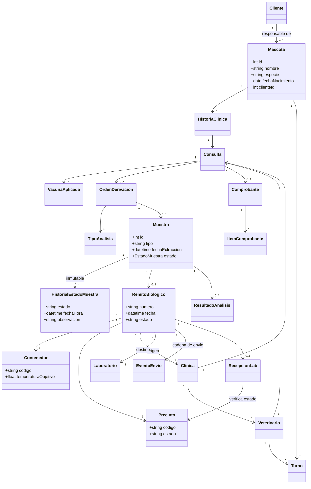
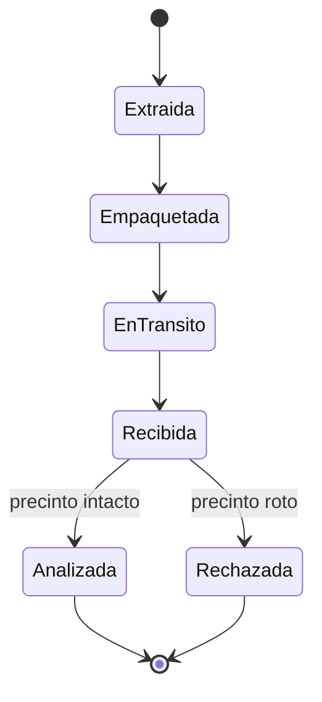

# Modelo de entidades

Diagrama de clases del sistema de Veterinaria: Red de Clínicas y Derivación de Laboratorio.

## Ciclo de vida de la muestra

## Reglas de negocio

- Toda mascota tiene un cliente responsable (obligatorio).
- Si el precinto llega roto, la muestra pasa a **Rechazada** y no se procesa.
- El historial de estados de la muestra es inmutable: solo se agregan registros.
- No puede haber turnos superpuestos para un mismo veterinario.
- Al registrar una atención se controla el esquema de vacunas obligatorias.